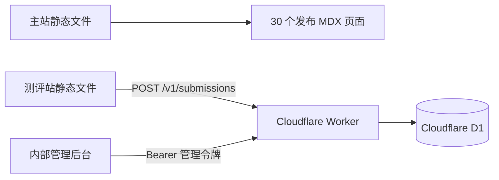

# LAIFU 系统架构

## 部署边界



| 工作区 | 运行形态 | 构建或检查结果 | 数据责任 |
| --- | --- | --- | --- |
| `apps/website` | Next.js 静态导出 | `apps/website/out/` | 读取发布内容，不接触答卷 |
| `apps/assessments` | Next.js 静态导出 | `apps/assessments/out/` | 浏览器本地计分，通过 Worker 提交结果 |
| `apps/admin` | Cloudflare Worker 上的 Next.js 服务端应用 | `.open-next/` OpenNext 产物 | 服务端访问 Worker 管理接口 |
| `workers/assessment-api` | Cloudflare Worker | Wrangler dry-run | 校验请求、执行业务查询、读写 D1 |

浏览器不持有管理令牌，也不直接连接 D1。主站和测评站均没有运行时数据库依赖。

## 数据流

### 公开提交

1. 测评站在浏览器中完成计分。
2. `POST /v1/submissions` 把结果和用户主动提交的联系方式发送给 Worker。
3. Worker 校验量表类型、服务意向、分数、答卷结构和联系方式。
4. Worker 写入 D1 的 `assessment_results` 表。

### 后台管理

1. 后台使用本地会话保护管理页面。
2. 后台的服务端代码使用 Bearer 管理令牌调用 Worker。
3. Worker 提供线索查询、详情读取、更新、删除和报告预览记录接口。
4. 管理令牌只存在于后台服务端和 Worker Secret 中。

后台通过 `@opennextjs/cloudflare` 部署。构建脚本会暂时隔离本地 `.env.local`，生产密钥只从 Cloudflare Worker Secret 注入，不进入部署产物。

## 环境变量

### 主站

| 变量 | 必需 | 用途 |
| --- | --- | --- |
| `NEXT_PUBLIC_SITE_URL` | 否 | 生成 canonical、sitemap、robots 和绝对分享地址 |

### 测评站

| 变量 | 必需 | 用途 |
| --- | --- | --- |
| `NEXT_PUBLIC_ASSESSMENT_API_URL` | 提交时必需 | Worker 的公开基础地址 |
| `NEXT_PUBLIC_MAIN_SITE_URL` | 正式发布时必需 | 页头、页脚和预约按钮返回主站 |
| `NEXT_PUBLIC_BASE_PATH` | 否 | 仅在测评站部署到子路径时填写；独立域名或 Cloudflare Pages 根路径保持为空 |

### 内部后台

| 变量 | 必需 | 用途 |
| --- | --- | --- |
| `ASSESSMENT_API_URL` | 是 | Worker 基础地址 |
| `ASSESSMENT_API_ADMIN_TOKEN` | 是 | 调用 Worker 管理接口 |
| `ADMIN_MVP_USERNAME` | 是 | 后台登录用户名 |
| `ADMIN_MVP_PASSWORD` | 是 | 后台登录密码 |
| `ADMIN_MVP_SESSION_SECRET` | 是 | 后台会话值 |
| `ADMIN_ALLOWED_ORIGINS` | 按部署环境 | 逗号分隔的 Server Action 允许来源 |

### Worker

| 配置 | 必需 | 用途 |
| --- | --- | --- |
| `ADMIN_API_TOKEN` | 是 | 校验后台 Bearer 令牌，长度至少 32 个字符 |
| `PUBLIC_ORIGINS` | 是 | 逗号分隔的公开提交来源白名单 |
| `DB` | 是 | Cloudflare D1 binding |

`ASSESSMENT_API_ADMIN_TOKEN` 与 `ADMIN_API_TOKEN` 必须使用同一个值。真实值只进入本地忽略文件或部署平台 Secret。

## 本地运行

先从示例文件创建本地配置，再填写本机值：

```bash
cp apps/assessments/.env.example apps/assessments/.env.local
cp apps/admin/.env.example apps/admin/.env.local
cp workers/assessment-api/.dev.vars.example workers/assessment-api/.dev.vars
```

初始化本地 D1：

```bash
pnpm --filter @laifu/assessment-api db:migrate:local
```

分别启动需要的部署单元：

```bash
PORT=3001 pnpm dev:website
PORT=3002 pnpm dev:assessments
PORT=3003 pnpm dev:admin
pnpm dev:api
```

构建 Cloudflare 生产产物（固定两个 Pages 域名和公开 API 地址，避免本机 `.env.local` 的 localhost 混入测评站）：

```bash
pnpm build:production
```

使用环境变量提供 Cloudflare 凭证后部署；后台沿用已有 Worker Secrets：

```bash
pnpm --filter @laifu/assessment-api exec wrangler pages deploy ../../apps/website/out --project-name laifu-web --branch main --commit-dirty=true
pnpm --filter @laifu/assessment-api exec wrangler pages deploy ../../apps/assessments/out --project-name laifu-assessments --branch main --commit-dirty=true
pnpm --filter @laifu/admin exec node scripts/run-opennext.mjs deploy -- --keep-vars
```

## 变更顺序

- 数据字段：先增加 D1 migration 和 Worker 合约，再同步测评提交端与后台读取端。
- 页面内容：30 个发布 MDX 页面，其中 28 个页面正文来自需求表映射，另 2 个保留既有内容。先使用 `scripts/extract-requirements.py` 直接提取工作簿所有工作表，再维护 `scripts/sync-requirements.mjs` 的明确映射；生成 MDX、结构化正文和页面注册表后，用 `scripts/audit-workbook-output.py` 将原表逐行与实际导出 HTML 校对。不要仅修改生成正文而遗漏映射规则。
- 视觉令牌：只编辑 `docs/design/system.md` 的 YAML frontmatter，再运行主站资产生成与设计审计。
- 三个前端共享 `styles/brand-tokens.css`，由设计源生成；后台和测评站只保留布局及兼容别名。`pnpm audit:css` 检查全部 CSS 的颜色来源、未定义变量、重复声明和 `!important`。后台报告 CSS 仅由报告路由加载，PNG/PDF 依赖按导出操作加载。
- 主站照片原始素材及授权记录位于 `apps/website/assets/photos/`；构建按需生成 640px、960px 和最高 1280px 的 WebP，清理过期尺寸，并生成供原有图片元素复用的尺寸与 srcset 清单。
- 中文字体使用带 `unicode-range` 的子集；只预加载首页正文与标题的常用字符，其他字符按需加载。原始字体保留在 `src/app/fonts/`，字符清单位于 `assets/font-subsets.json`；安装 `fonttools[woff]` 后运行 `python3 apps/website/scripts/prepare-fonts.py` 可再生成带内容哈希的字体和 CSS。正常构建不依赖 Python。
- 测评站字体同样按首屏与其余问卷/结果用字拆分，避免载入通用中文字库；字体来源、SHA-256、许可及字符覆盖表记录在 `apps/assessments/assets/fonts/`。按 `source.json` 下载原始字体后，运行 `python3 apps/assessments/scripts/prepare-fonts.py /path/to/NotoSansSC.ttf` 更新。结构检查会拒绝缺少新文案汉字的旧子集。
- 主站样式入口只负责按层导入；11 个职责独立的样式模块分别拥有基础、布局、控件、导航、Hero、内容、集合、口碑、编辑排版、表单与页脚规则，不跨应用读取样式来验收。
- 展示复用 `ContentPrimitives` 中的 CardGrid、Steps、CTAFrame、SectionFrame、StatusNotice；页面组合、块派发、富文本拆分、数据类型分离。布局不能通过深层后代选择器把网格跨度传给正文。
- 部署配置：每个工作区只维护自身的 Next.js 或 Wrangler 配置。
- 新增文档：先确认属于长期有效的工程事实；临时方案和编辑过程不进入版本库。

## 验证

```bash
pnpm check
```

该命令是推送前的完整验收入口。单项命令以根目录 `package.json` 为准。

2026-09-03 工作簿的版本优先级、建议落实情况与发布材料缺口见 [需求核对记录](requirements/update-2026-09-03.md)。主站的筛选、逐级导航、折叠详情及本地自查使用原生 HTML/CSS，不新增客户端运行时代码。旧离婚启动服务和旧全周期服务地址只保留新版入口说明，不再展示旧方案。

Playwright 除了检查主站与测评站的响应式页面，还会使用本地 D1 完成一次公开提交、后台鉴权、筛选、详情、更新、报告预览和删除的完整数据生命周期。
