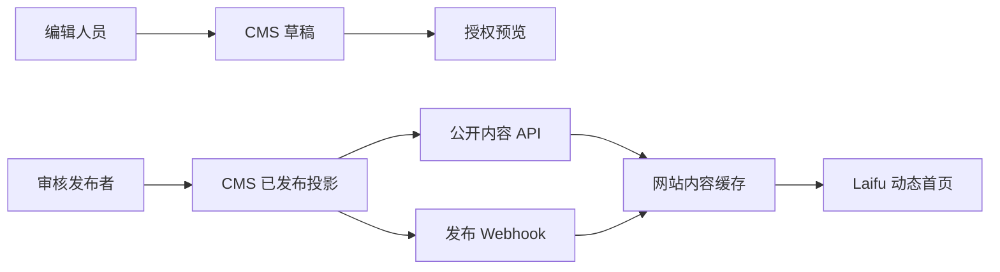

# Laifu CMS 首页闭环设计

状态：待实现  
设计基线：2026-10-14 本地首页  
适用范围：`apps/website` 首页与 Laifu Payload CMS

## 1. 目标与验收口径

本阶段只完成首页内容管理闭环，不扩展到全部内页。闭环完成后，内容编辑人员应能在 CMS 中修改首页内容、预览草稿、提交审核并发布；发布后，正式首页在 60 秒内显示新内容，无需重新部署前端。

验收必须同时满足：

1. 首页视觉、布局、动效和交互行为继续由前端代码控制。
2. 首页可编辑文案、图片、入口和关联内容来自 CMS，前端不再保留第二份运行时内容。
3. 草稿只能在授权预览中出现，公开接口只返回已发布版本。
4. CMS 暂时不可用时，线上优先返回最近一次有效缓存；冷启动且无有效缓存时明确返回 503，不静默回退到本地旧文案。
5. 发布、撤回和缓存刷新均留下审计记录。

## 2. 已确认的产品假设

- 当前首页视觉方案已经通过本阶段设计确认，CMS 不提供自由拖拽和样式编辑。
- 第一版只管理简体中文；字段结构保留 Payload localization 的后续扩展能力。
- 网站改为支持服务端运行的 Next.js 应用，不继续使用纯静态 `output: "export"` 作为生产形态。
- CMS、网站、测评站和测评数据后台是四个独立部署单元。
- CMS 使用 PostgreSQL；生产媒体进入对象存储，不写入应用本地磁盘。
- 首页 URL、区块类型、区块顺序、交互逻辑和评估规则属于代码合同，普通编辑不可修改。

## 3. 首页结构与内容归属



| 页面部分 | CMS 管理 | 代码管理 |
| --- | --- | --- |
| 顶部导航 | 链接文字、目标、测评入口 | 桌面/移动布局、菜单行为、图标 |
| Hero | 标题、简介、图片、按钮、搜索占位文案 | 图片构图、排版、搜索算法、搜索结果交互 |
| 婚姻旅程 | 开场、5 个阶段的标题与说明、两组行动清单 | 固定 5 阶段、滚动时间轴、Canvas 线团动效、动画时序 |
| 服务入口 | 标题、5 个入口、图片、说明、行动文字 | 固定树状布局、卡片尺寸、分支动画 |
| 首页自测 | 区块标题、说明、CTA | 题目权威源、答案选项、计分、提交和交互逻辑 |
| 常见问题 | FAQ 正文及关联情境 | Tab、键盘操作、展开收起、轮换逻辑 |
| 免费指南 | 首页展示标题、封面、摘要、入口 | 翻页器、试读内容加载、阅读器交互 |
| 末尾邀请 | 标题、说明、三个行动入口 | 布局、按钮风格和响应式行为 |
| 页脚 | 分栏、链接、品牌陈述、免责声明 | 网格、品牌图形、年份生成规则 |
| SEO | 标题、描述、分享图 | canonical、robots、结构化数据规则 |

## 4. CMS 内容模型

### 4.1 `home-presentations`

单例语义的版本化 Collection，只允许存在 `key=home` 的一条有效记录。

公共字段：

| 字段 | 类型 | 约束 |
| --- | --- | --- |
| `internalTitle` | text | 必填，仅后台识别 |
| `key` | text | 固定为 `home`，创建后不可修改 |
| `seo.title` | text | 必填，建议 25–32 个汉字，硬上限 60 个字符 |
| `seo.description` | textarea | 必填，80–160 个汉字 |
| `seo.shareImage` | relationship → media | 必填，建议 1200×630 |
| `_status` | Payload draft/published | 发布者才能切换为 published |
| `contentVersion` | computed | 使用已发布文档更新时间，不允许手填 |

#### `hero`

| 字段 | 类型 | 约束 |
| --- | --- | --- |
| `titleLines` | array{text} | 固定 2 行；每行 6–18 个汉字 |
| `introLines` | array{text} | 1–2 行；每行不超过 55 个汉字 |
| `image` | relationship → media | 必填；桌面建议 3:2，必须有 alt |
| `searchPlaceholder` | text | 必填，不超过 50 个汉字 |
| `primaryAction` | action | 固定用途为预约咨询 |
| `secondaryAction` | action | 固定用途为跳转服务入口 |
| `journeyLinkLabel` | text | 不超过 20 个汉字 |
| `journeySummary` | text | 不超过 30 个汉字 |

`action` 统一包含 `label`、`href`、`openInNewTab`。站内地址必须以单个 `/` 开头；`#` 只允许指向合同登记的首页锚点；外部地址只允许 HTTPS 且命中允许域名。

#### `journey`

- `openingTitle`：必填，不超过 24 个汉字。
- `openingBodyLines`：固定 1–2 行。
- `stages`：固定 5 条，不允许增加、删除或调整顺序。
- 每条阶段包含不可修改的 `key`、短标签、1–2 行标题和 1–2 行说明。
- `clarify` 与 `action` 两个阶段额外允许 3 条文档清单；其他阶段不显示该字段。
- Canvas 参数、`data-start`、`data-end`、进度条和动画曲线不进入 CMS。

固定阶段键：

```text
stabilize  稳状态，破内耗
clarify    清全局，辨利弊
decide     定决策，稳落地
action     拆解步骤，有序推进
followup   稳妥推进，降低损耗
```

#### `services`

- `titleLines`：固定 2 行。
- `items`：固定 5 个槽位，不允许增删或改变顺序。
- 每项包含 `key`、1–2 行标题、说明、行动文字、站内链接和媒体关系。
- 图片统一要求横向 3:2，建议最小 960×640。
- 单项说明不超过 90 个汉字，行动文字不超过 12 个汉字。

固定槽位键：`coaching`、`highConflict`、`courses`、`community`、`academy`。

#### `assessment`

CMS 只管理：

- `titleLines`
- `descriptionLines`
- `action`
- `note`

首页展示的三个题目必须引用测评系统提供的稳定题目 ID。题干、选项、计分和提交逻辑不得复制进 CMS。接入测评题目接口前，现有题目继续由前端代码控制，并在 CMS 后台显示为只读说明。

#### `featuredFaqs`

- relationship → `faqs`
- 固定选择 5 条已发布 FAQ
- 不允许在首页文档中重复填写 FAQ 正文
- 发布首页时校验所有关联 FAQ 均为 published

#### `guides`

- 固定 3 个展示槽位。
- 每项包含栏目文字、2 行标题、2 行摘要、封面媒体、元信息、站内链接。
- 这里只管理首页导览卡片，不管理正式指南正文和下载文件。
- 正式资源模型建立后改为 relationship；在此之前不得在其他页面复制这组导览文案。

#### `invitation`

- `title`：必填，不超过 28 个汉字。
- `descriptionLines`：1–2 行。
- `actions`：固定 3 个槽位，分别为预约、测评、全部服务。
- `assessmentNote`：不超过 45 个汉字。

### 4.2 `faqs`

FAQ 是首页和未来 FAQ 页面共享的唯一内容源。

| 字段 | 类型 | 约束 |
| --- | --- | --- |
| `internalTitle` | text | 后台识别名称 |
| `question` | text | 必填，不超过 45 个汉字 |
| `lead` | text | 必填，不超过 55 个汉字 |
| `answer` | textarea | 必填，不超过 400 个汉字 |
| `contexts` | array | 1–3 条 |
| `contexts.label` | text | 不超过 10 个汉字 |
| `contexts.copy` | textarea | 不超过 160 个汉字 |
| `contexts.action` | optional action | 仅在需要继续阅读时填写 |
| `followups` | array | 1–3 条问答 |
| `category` | select | 服务、流程、隐私、费用、专业边界 |
| `_status` | drafts | 公开接口只输出 published |

### 4.3 `site-navigation`

单例语义的版本化 Collection：

- `primaryLinks`：最多 6 条。
- `assessmentAction`：测评入口。
- `footerColumns`：4–6 栏，每栏最多 6 条链接。
- `footerStatement`：品牌陈述。
- `footerDisclaimer`：服务边界提示。
- Logo、菜单图标和布局不进入 CMS。

### 4.4 `media`

必须包含 `alt`、宽度、高度、mimeType、文件大小和来源说明。生产上传使用对象存储。首页 Hero、服务卡片和指南封面在发布前校验尺寸与比例，缺少 alt 时禁止发布。

## 5. 公开 API 合同

```text
GET /api/public/v1/laifu/home-presentation
GET /api/public/v1/laifu/navigation
```

成功响应：

```json
{
  "apiVersion": "v1",
  "projectionVersion": "2026-10-14",
  "contentVersion": "2026-10-14T10:20:30.000Z",
  "data": {
    "presentation": {}
  }
}
```

合同规则：

- 只输出前端需要的白名单字段，不直接暴露 Payload 文档。
- 没有已发布文档时返回 404，并使用 `Cache-Control: no-store`。
- 成功响应带 ETag，并支持 `If-None-Match` 返回 304。
- 响应带 `Cache-Control: public, s-maxage=60, stale-while-revalidate=86400`。
- 字段缺失、版本不匹配或关联内容未发布时，投影失败并阻止发布。
- 网站与 CMS 共用一份无框架 TypeScript 合同；权威合同保存在网站侧，CMS 使用导出快照。

## 6. 网站读取与动态渲染

网站新增统一服务端客户端 `cms-content-client`，职责包括：

1. 校验 CMS URL 为允许的 HTTPS 来源。
2. 设置请求超时和 Correlation ID。
3. 验证 API、投影和字段版本。
4. 验证页面字段约束及站内链接。
5. 按 `home`、`navigation` 标签缓存有效投影。
6. 记录 CMS 不可用、版本不兼容和缓存命中情况。

首页组件改为接收强类型 props，不允许组件内部继续保留相同文案。视觉 CSS、Canvas 动效、搜索、自测和翻页器逻辑保持在组件中。

生产失败策略：

- CMS 请求成功：校验后更新缓存并渲染。
- CMS 请求失败且存在有效旧缓存：继续返回旧缓存并记录告警。
- CMS 请求失败且没有缓存：返回明确的 503 页面。
- 不允许自动读取现有 `home-content.ts` 作为生产回退。

## 7. 草稿预览

预览入口由 CMS 生成一次性短时令牌：

```text
GET /preview/home?id={documentId}&locale=zh-CN&token={signedToken}
```

预览流程：

1. CMS 编辑人员保存草稿。
2. CMS 生成 5 分钟有效的签名预览 URL。
3. 网站验证签名、文档 ID、用户权限和来源。
4. 网站进入 Draft Mode，从受保护接口读取指定草稿。
5. 预览响应设置 `noindex, nofollow` 和 `Cache-Control: private, no-store`。
6. 离开预览时清除 Draft Mode Cookie。

预览必须复用正式首页组件，不能维护一套独立的近似预览页面。

## 8. 审核、发布与缓存刷新

角色：

- `editor`：创建和修改草稿、查看预览，不能发布。
- `publisher`：审核、发布和撤回。
- `admin`：账号、权限、系统配置和迁移。

发布流程：

```text
编辑草稿
→ CMS 字段校验
→ 前端真实预览
→ 发布者审核
→ 生成公开投影
→ 写入发布事件
→ 签名 Webhook 通知网站
→ 网站刷新 home/navigation 缓存标签
→ 自动探测公开 API 与正式首页
→ 记录成功或失败
```

Webhook 要求：

- HMAC 签名、时间戳和重放保护。
- 事件 ID 幂等。
- 只携带文档类型、文档 ID、内容版本和缓存标签，不携带完整正文。
- 最多指数退避重试 5 次。
- 缓存刷新失败不伪装成发布成功；CMS 后台展示“内容已发布，网站刷新失败”。

## 9. 当前代码到 CMS 的迁移映射

| 当前来源 | 迁移目标 |
| --- | --- |
| `HomeSections.tsx` 的 Hero 文案 | `home-presentations.hero` |
| `HomeJourney.tsx` | `home-presentations.journey` |
| `home-content.ts` 的 `homeServices` | `home-presentations.services.items` |
| `HomeSections.tsx` 的自测区说明 | `home-presentations.assessment` |
| `HomeFAQ.tsx` 的 `faqItems` | `faqs` + `home-presentations.featuredFaqs` |
| `HomeSections.tsx` 的 `guides` | `home-presentations.guides` |
| `HomeInvitation` | `home-presentations.invitation` |
| `HomeNavigation.tsx` 的 `primaryLinks` | `site-navigation.primaryLinks` |
| `home-content.ts` 的 `homeFooterColumns` | `site-navigation.footerColumns` |
| `HomeFooter` 品牌陈述与免责声明 | `site-navigation` 对应字段 |
| `page.tsx` metadata 文案 | `home-presentations.seo` |

迁移脚本必须可重复运行：按固定 key upsert，先生成草稿，校验通过后由发布者手动发布。迁移完成并经过一个发布周期后，才移除前端重复常量。

## 10. 实施顺序

### 阶段 A：合同和 CMS 模型

- 建立 Laifu 首页 TypeScript 合同。
- 将 AceVec CMS 复制为独立 Laifu CMS 工作项目并完成品牌隔离。
- 创建 `home-presentations`、`faqs`、`site-navigation` 和媒体字段。
- 添加数据库迁移、字段校验和权限。
- 实现公开投影与合同测试。

验收：使用合成已发布文档调用两个公开接口，合同校验通过；草稿请求公开接口返回 404。

### 阶段 B：动态首页消费者

- 将主站从纯静态导出调整为服务端部署。
- 建立 CMS 客户端、运行时校验和缓存。
- 将首页组件改为强类型 props。
- 接入首页和导航公开接口。
- 保持现有视觉和交互像素级一致。

验收：CMS 数据变化能出现在本地动态首页；CMS 不可用时命中旧缓存；无缓存时返回 503。

### 阶段 C：预览和发布

- 接入 Draft Mode 与短时预览令牌。
- CMS Live Preview 指向真实首页。
- 实现发布事件、签名 Webhook、缓存标签刷新和结果探测。
- 实现后台状态反馈和审计。

验收：编辑草稿时公网不可见；授权预览可见；发布后 60 秒内正式首页更新；Webhook 重放不会重复执行。

### 阶段 D：迁移和切换

- 导入当前首页、FAQ、导航和页脚内容。
- 内容负责人逐项核对桌面与移动端。
- 在预发布环境完成发布、撤回、缓存失败和恢复演练。
- 切换生产内容源并观察一个完整发布周期。

验收：首页不存在运行时双内容源；CMS、网站与审计日志记录同一内容版本。

## 11. 本阶段明确不做

- 不设计或迁移全部内页内容模型。
- 不把首页做成自由拖拽页面搭建器。
- 不把 CSS、字体、色彩、动画参数和响应式断点放进 CMS。
- 不复制测评题库、答案、计分或提交逻辑到 CMS。
- 不开放编辑人员修改路由、页面组件类型或系统锚点。
- 不在本阶段接入正式指南下载、预约支付或客户线索数据。

## 12. 完成定义

只有以下检查全部通过，才算“CMS 首页闭环完成”：

- CMS 首页字段、FAQ、导航和媒体迁移可在空数据库执行。
- 编辑、发布和管理员权限符合角色约束。
- CMS 公开 API、草稿隔离、ETag 和错误路径测试通过。
- 网站类型检查、单元测试和首页端到端测试通过。
- 桌面、平板和手机截图与当前批准设计一致。
- 键盘操作、焦点、标题层级和表单标签检查通过。
- 发布、撤回、缓存刷新失败和 CMS 临时不可用均经过演练。
- 生产数据库备份、对象存储和回滚步骤已有文档并实际验证。
